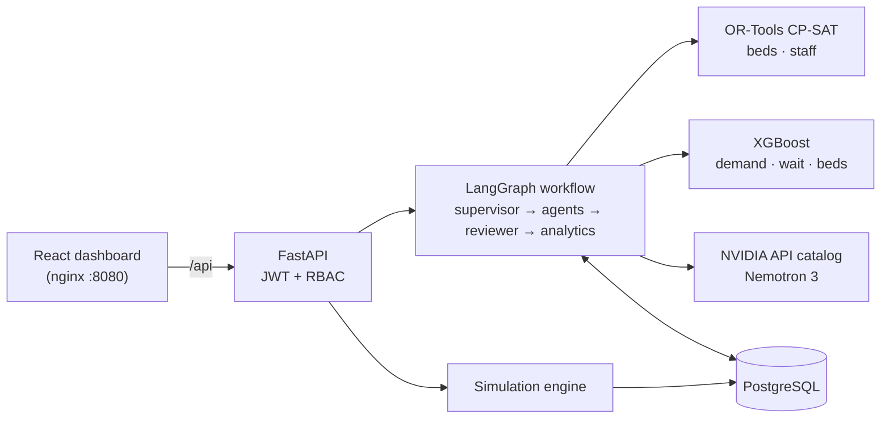
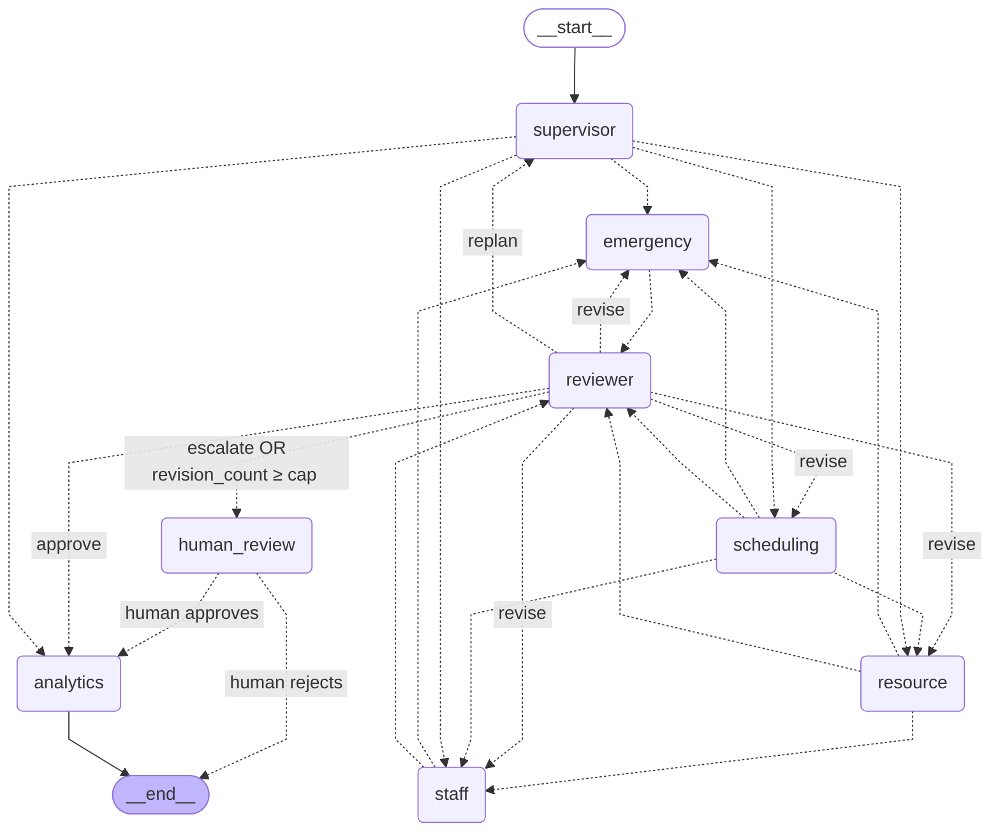

# Hospital Workflow Agent

**A multi-agent AI system for hospital operations: scheduling, bed allocation, staff coordination
and emergency response.** Built with LangGraph, FastAPI, PostgreSQL, React, XGBoost, OR-Tools and
the NVIDIA API catalog.

A supervisor sends each request to specialist agents. Their plans are produced by optimisation
solvers and ML models, then checked by a reviewer that enforces hard safety rules. The reviewer
can send work back, ask for a different plan, or hand the decision to an administrator with a
precise explanation. An analytics agent explains every decision in plain language.

> **Decision support only. Not a clinical tool.** All data is synthetic (generated with Faker,
> pandas and NumPy); there is no real patient information. The system never diagnoses or
> recommends treatment. Final decisions rest with qualified staff.

---

## Quick start

You need **Docker Desktop** (running) and a **free NVIDIA API key** from
<https://build.nvidia.com> (open any model, then *Get API Key*).

```bash
git clone https://github.com/radio12312/HOSPITAL_AI_AGENT.git
cd HOSPITAL_AI_AGENT
```

**Windows:** double-click `start.bat`. **macOS / Linux:** run `./start.sh`.

The script asks for your API key once (hidden input, stored only in the git-ignored `.env`) and
runs `docker compose up --build`. On first start it generates the synthetic hospital, loads
PostgreSQL and trains the models. It then opens <http://localhost:8080>. The first build takes
3–5 minutes; later starts take seconds.

| Demo account | Password | Role |
|---|---|---|
| `admin` | `admin123` | Admin: everything, including scenarios and overrides |
| `doctor` | `doctor123` | Doctor: own appointments, assigned patients, schedule suggestions |
| `coordinator` | `coord123` | Staff Coordinator: staff workloads, rebalancing, staffing advice |

Stop with `docker compose down`. To start over with fresh data, run `docker compose down -v`.

---

## What it does

| Page | What you can do |
|---|---|
| **Dashboard** | Admissions today, bed and ICU occupancy, staff availability, emergency alerts, predicted waiting time, resource utilisation; 14-day admissions trend with a 7-day XGBoost forecast; recommendations to accept or override |
| **Patients / Appointments** | Search and admit patients; book appointments where the Scheduling Agent picks the doctor and a conflict-free slot with the lowest predicted wait |
| **Beds** | Live bed grid by ward; run the OR-Tools bed optimiser |
| **Staff** | Department workload; preview and apply OR-Tools staff rebalancing |
| **Emergency Center** | Surge detection, register incoming cases, and run the five built-in scenarios |
| **AI Assistant** | Ask questions in plain English; see which agents answered, the reviewer's verdicts, and approve or reject escalated plans |

Built-in scenarios (each resets to the seeded baseline first, then the agents react):

| Scenario | What happens | Expected agent outcome |
|---|---|---|
| Normal Operating Day | Baseline: about 80% occupancy | Approved first time |
| Monday Morning Rush | Clock moves to Monday 09:00; 140 extra morning appointments; 14 admissions waiting | Approved; 20 patients bedded, utilisation 91% |
| ICU Capacity Shortage | ICU filled to 29/30; 4 more critical patients | **Escalated** to an administrator (infeasible) |
| Mass Casualty Emergency | 16 emergency cases (8 critical) plus 6 critical trauma admissions | **Escalated** (ICU short by 9) |
| Staff Shortage Event | Nurses call in sick; workload rises. *Demo mechanism: the first staffing plan deliberately breaks the workload cap* | **Revised once**, then approved |

---

## Architecture



The full component diagram and the reasons behind each design choice are in
[`docs/architecture.md`](docs/architecture.md).

### The agent graph

Generated from the compiled LangGraph by `backend/scripts/export_graph.py`
(`get_graph().draw_mermaid()`), so it always matches the code
([`docs/graph.mmd`](docs/graph.mmd)). Dotted arrows are conditional edges.



### The agents

| Node | Uses | What it does | Output example |
|---|---|---|---|
| **supervisor** | keywords, LLM only for unrecognised questions | Chooses the agents a request needs, limited to the user's role (doctor: scheduling; coordinator: staff; admin: all). Scenario runs use every permitted agent. | `Routed to resource, staff` |
| **scheduling** | XGBoost wait model, appointment DB | Matches patient and doctor, predicts consultation length and wait, finds a conflict-free slot, flags overloaded doctors. | `{"doctor": "Dr. Smith", "recommended_slot": "10:30 AM", "predicted_wait_time": "15 min"}` |
| **resource** | OR-Tools CP-SAT | Beds waiting patients (critical patients go only to ICU, children to pediatric beds), ward utilisation, constrained equipment. | `{"assigned_bed": "ICU-12", "utilization_score": 92}` |
| **staff** | OR-Tools CP-SAT | Reallocates movable on-duty staff to meet 6 patients per staff member without exceeding the workload cap of 100. | `{"staff_reallocation": [{"from": "Ward B", "to": "Ward A", "staff_count": 3}]}` |
| **emergency** | rules, XGBoost bed-demand model | Detects surges, reserves ICU beds after the resource plan, assigns surgeons, forecasts tomorrow's beds, raises alerts. | `{"priority_level": "Critical", "recommended_actions": ["Reserve 4 ICU Beds", "Assign 2 Surgeons"]}` |
| **reviewer** | deterministic hard checks | Double-booked beds, bed type vs acuity, unbedded patients, workload cap, uncovered departments, doctor availability and slot conflicts, ICU reservations, missing agents. Chooses the verdict. | `REVISE (workload_cap: S007 would reach 107 > 100)` |
| **human_review** | LangGraph `interrupt()` | Pauses the run with the best plan so far, unresolved violations and why it escalated; resumes on an administrator's decision. | `reason: infeasible` |
| **analytics** | NVIDIA NIM (Nemotron 3) | Answers the question and explains decisions using only facts from the database, agent outputs and forecasts. Turns outputs into reviewable recommendations. | *"ICU is at 96.7% occupancy with only 1 free bed…"* |

### State schema

`HospitalWorkflowState` (`backend/langgraph_workflow/state.py`) is a `TypedDict`; nested
structures are Pydantic models (`Review`, `Violation`, `HumanDecision`). `history` and `trace`
use an `operator.add` reducer, so they are append-only.

| Field | Written by | Read by |
|---|---|---|
| `query`, `user_role`, `mode`, `scenario_id`, `patient_info` | runner (input) | supervisor, scheduling, analytics |
| `inject_fault` | runner (Staff Shortage demo) | staff agent |
| `reviewer_mode`, `max_revisions` | runner (`.env`) | reviewer, `route_after_review` |
| `selected_agents` | supervisor | reviewer (missing-agent check), `route_next` |
| `pending_agents` | supervisor, each agent (pops itself), reviewer (revise targets) | `route_next`, `route_after_review` |
| `appointment_info` | scheduling agent | reviewer, analytics |
| `resource_status` | resource agent | emergency agent, reviewer, analytics |
| `staff_status` | staff agent | reviewer, analytics |
| `emergency_status` | emergency agent | reviewer, analytics |
| `constraints` | reviewer (violations as solver constraints, e.g. exclude staff S007) | agents on their next attempt |
| `attempts` | each agent | staff agent (fault injection on attempt 1 only) |
| `review` | reviewer | routing, supervisor (replan), human_review |
| `revision_count` | reviewer (+1 on every rejection) | `route_after_review` |
| `history` (append-only) | reviewer (every attempt: verdict, violations, feedback, decision hash, outputs) | human_review, API |
| `human_decision`, `escalation` | human_review | `route_after_human`, analytics |
| `status` | reviewer, human_review, analytics | API |
| `recommendations`, `answer` | analytics | runner (saved to DB), API |
| `llm_calls`, `trace` (append-only) | every LLM node / every node | API, UI |

### Conditional edges

Three routing functions in `backend/langgraph_workflow/routing.py` make the decisions:

- **`route_next`** (after the supervisor and after each operational agent): go to the next queued
  agent; when the queue is empty, go to the reviewer, or straight to analytics for questions that
  need no operational agent (e.g. *"Predict patient demand tomorrow"*).
- **`route_after_review`**, the main decision:

```python
def route_after_review(state: dict) -> ReviewRoute:
    review = state.get("review")
    if review is None:
        raise ValueError("route_after_review called before the reviewer wrote a review")
    if review.verdict == "approve":
        return "analytics"
    if review.verdict == "escalate":
        return "human_review"
    if state.get("revision_count", 0) >= state.get("max_revisions", DEFAULT_MAX_REVISIONS):
        return "human_review"
    if review.verdict == "replan":
        return "supervisor"
    pending = state.get("pending_agents") or review.target_agents
    return pending[0] if pending else "analytics"
```

- **`route_after_human`**: approve goes to `analytics`; reject goes to `END`.

The reviewer picks the verdict in this order (`reviewer.py::decide`): any capacity violation or
`INFEASIBLE` solver result means **escalate**; outputs identical to the previous attempt (decision hash)
mean **escalate**; a plan violation (e.g. a surge detected but staffing not reviewed) means **replan**;
any other violation means **revise** the offending agents, with the violations turned into constraints;
otherwise **approve**.

### What happens when the reviewer rejects twice

With the default `MAX_REVISIONS=2`:

1. **Rejection #1.** The reviewer returns `revise` (or `replan`), increments `revision_count` to **1**,
   appends attempt 1 to `history`, and adds solver constraints from the violations (e.g. *exclude
   staff S007*). Since `1 < 2`, the graph routes back to the flagged agent, which re-runs with the
   new constraint.
2. **Rejection #2.** The reviewer rejects again, increments `revision_count` to **2**, appends attempt 2
   and sets `status = "needs_human"`. Now `2 >= 2`, so `route_after_review` returns `human_review`.
   **There is no third attempt.**
3. **Interrupt.** `human_review` calls `interrupt()` with the **best plan so far** (the attempt with the
   fewest violations, ties going to the latest), every **unresolved violation**, and a one-paragraph
   **summary** of why it stopped (`cap`). The run is checkpointed under its `thread_id`. The API
   returns `status: "needs_human"`, and the UI shows an *Approve / Reject* panel to administrators.
4. **Resume or end.** `POST /agent/resume` sends `Command(resume={"action", "note"})`. The node
   re-runs, `interrupt()` returns the decision, and:
   - **approve:** `status = human_approved`; the best plan's outputs are restored; the analytics
     agent writes a report that says an administrator approved it, quotes their note and lists the
     unresolved issues.
   - **reject:** `status = human_rejected`, then `END`. No recommendations are saved.

**Why the cap exists.** An agent and a reviewer can disagree forever: the request may be impossible,
or the feedback may not map to any change. Each loop costs time and API calls, possibly during an
emergency. The cap bounds the worst case. In fixed mode, escalation usually ends the loop earlier,
as soon as retrying is pointless (see below).

**Audit trail.** `history` is append-only: every attempt keeps its verdict, violations, feedback,
decision hash and outputs. It is returned by the API, shown as a timeline in the UI, and written
to file by the CLI `--save-trace` option.

`escalate` also counts as a rejection (it increments `revision_count`); `approve` is appended to
`history` but doesn't increment it.

### Failure mode: retrying the impossible

With the original **naive** reviewer, *Mass Casualty Emergency* (ICU short by 9 beds) made the agents
produce the **same** infeasible plan on every attempt (identical decision hash `53b4b0da…`). The
reviewer kept asking the LLM how to fix it, and the run stopped only when the cap forced escalation:
3 LLM calls at cap 2 and 5 at cap 4, instead of 1. The LLM's suggested fixes even included a
clinical recommendation (*"a validated triage score (e.g., SOFA or APACHE-II)"*). The **fixed**
reviewer recognises infeasibility and identical drafts, and escalates on the first review with the
exact shortfall. Real traces, the root cause, why it matters in a hospital, and the other failure
modes found during development are in **[`docs/FAILURE_MODE.md`](docs/FAILURE_MODE.md)**.

---

## Machine learning

Three XGBoost regressors (`backend/ml/`), trained by `seed_data.py` (or `python -m ml.train`) on the
generated data with a time-based train/test split. Metrics from the seeded dataset:

| Model | Inputs | Output | Test MAE | R² |
|---|---|---|---|---|
| Patient demand | day_of_week, department, historical_admissions (previous 7-day mean) | expected admissions per department per day | 2.0 | 0.39 |
| Waiting time | doctor_load, appointments_count (same department and hour), department | expected wait (min) | 3.2 min | 0.61 |
| Bed demand | occupancy_rate, admissions, emergency_cases | occupied beds tomorrow | 12.8 beds | 0.29 |

The bed-demand model is the weakest: there are only about 100 days of patient history and
22 test days, so treat its forecast as indicative.

## Synthetic data

`seed_data.py` generates 5,000 patients, 50 doctors, 20,000 appointments, 100 staff, 200 beds,
1,000 emergency cases and 161 pieces of equipment, writes them to `backend/data/*.csv`, and loads
PostgreSQL. The generator (`backend/seed/generator.py`) encodes these patterns:

1. Mondays have the most admissions (Mon 970 vs Sun 516 in the seeded data).
2. Appointment load peaks 8 AM–12 PM.
3. Emergency cases rise at night (46% arrive between 20:00 and 04:00).
4. ICU occupancy is held between 70% and 95% (83% at baseline).
5. Cardiology and General Medicine have the highest inflow.
6. Weekends have fewer staff on duty.
7. Seasonal spikes: flu season (Dec–Feb), a three-week viral outbreak, holiday surges.
8. Critical patients (severity ≥ 8) have long stays (11.8 days vs 3.3) and go to the ICU.

The dashboard runs on a **hospital clock** (a mid-week morning fixed at seeding, moved by
scenarios), so the numbers stay meaningful whenever you open the app.

---

## API

Interactive docs: <http://localhost:8000/docs>. The full reference with request and response
shapes is in [`docs/API.md`](docs/API.md).

| Method | Path | Roles | Purpose |
|---|---|---|---|
| POST | `/auth/login` | public | JWT login |
| GET | `/auth/me` | all | Current user |
| GET | `/dashboard` | all | KPIs, trends, forecasts, alerts |
| GET / POST | `/patients` | admin, doctor (own) / admin | List / admit patients |
| GET | `/doctors` | all | Doctors with today's load |
| GET / POST | `/appointments` | admin, doctor | List / book (Scheduling Agent picks doctor and slot) |
| GET | `/beds` | admin, doctor | Beds and ward summary |
| POST | `/beds/allocate` | admin | Run and apply the bed optimiser |
| GET | `/staff` | admin, coordinator | Staff and department workload |
| POST | `/staff/rebalance` | admin, coordinator | Preview or apply staff reallocation |
| GET / POST | `/emergency` | admin | Active cases and surge / register cases and run the Emergency Agent |
| POST | `/agent/query` | all | Ask the agents (LangGraph workflow) |
| POST | `/agent/resume` | admin | Approve or reject a run paused for human review |
| GET | `/scenarios` · POST `/scenarios/{id}/run` · POST `/scenarios/reset` | admin | Simulation engine |
| GET | `/recommendations` · POST `/recommendations/{id}/decision` | all / admin | Review, accept (apply) or override agent recommendations |
| GET | `/health`, `/clock` | public / all | Status, hospital clock |

### Example questions for the AI Assistant

- *Show bed utilization.*
- *Which ward is overloaded?*
- *Predict patient demand tomorrow.*
- *Why was a patient delayed?*
- *What staffing changes are recommended?*
- *Which resources are constrained?*

Each answer shows the agents used, the reviewer's verdict history, and how many LLM calls it took
(usually one).

---

## Running locally without Docker

Requires Python 3.11+, Node 20+ and a PostgreSQL database (for example
`docker run -d -p 5432:5432 -e POSTGRES_USER=hospital -e POSTGRES_PASSWORD=hospital -e POSTGRES_DB=hospital postgres:17-alpine`).

```bash
cp .env.example .env
```

Add your key to `.env`, then start the backend:

```bash
cd backend
python -m venv .venv
.venv/bin/pip install -r requirements.txt        # Windows: .venv\Scripts\pip
.venv/bin/python seed_data.py                    # generate data, load DB, train models (~20 s)
.venv/bin/uvicorn main:app --reload --port 8000
```

Then the frontend, in a second terminal:

```bash
cd frontend
npm install
npm run dev                                      # http://localhost:5173 (proxies /api to :8000)
```

Command-line scenario runner, which prints the full agent trace:

```bash
cd backend
.venv/bin/python scripts/run_scenario.py --scenario mass_casualty --mode naive --max-revisions 2 --auto-human approve
```

## Configuration

Set in `.env` (see [`.env.example`](.env.example)):

| Variable | Default | Purpose |
|---|---|---|
| `NVIDIA_API_KEY` | (none) | Key from build.nvidia.com |
| `JWT_SECRET` | `change-me-in-production` | Token signing secret |
| `DATABASE_URL` | local PostgreSQL | Set automatically by Docker Compose |
| `NVIDIA_MODEL` / `NVIDIA_FALLBACK_MODEL` | Nemotron 3 Super / Ultra | Probed at startup; the fallback is used if the primary fails |
| `NVIDIA_DISABLE_THINKING` | `true` | Faster responses (`chat_template_kwargs.enable_thinking=false`) |
| `LLM_CACHE_ENABLED` | `true` | On-disk response cache keyed by (model, prompt) |
| `REVIEWER_MODE` | `fixed` | `naive` reproduces the failure mode |
| `MAX_REVISIONS` | `2` | Rejections before human review |

**Free-tier friendly:** all optimisation, prediction, rule checking and revision feedback is
deterministic, so most requests make a single LLM call. Calls retry with exponential backoff on 429
and 5xx errors, and repeated prompts are served from the cache.

**Model note:** the spec named Llama 3.1 70B Instruct, but that model (and several others) returns
HTTP 410 *Gone* in the NVIDIA catalog while still being listed. The service probes models at
startup and uses Nemotron 3 Super with Nemotron 3 Ultra as fallback.

## Project structure

```
backend/
  main.py                FastAPI app
  seed_data.py           generate CSVs, load PostgreSQL, train models, create demo users
  agents/                scheduling, resource, staff, emergency, analytics agents
  langgraph_workflow/    state schema, supervisor, reviewer, human review, routing, graph, runner
  services/              nvidia_llm.py (LLM client), hospital_state.py (queries), actions.py
  ml/                    XGBoost predictors + train.py
  optimization/          bed_optimizer.py, staff_optimizer.py (OR-Tools)
  simulation/            hospital_simulator.py (5 scenarios)
  api/routes/            REST endpoints
  core/                  config, security (JWT/bcrypt), RBAC dependencies, logging, constants
  database/ models/ schemas/ seed/ scripts/
frontend/                React + TypeScript + Tailwind + Recharts (Vite), nginx Dockerfile
docs/                    architecture.md, API.md, graph.mmd, FAILURE_MODE.md, runs/ (real traces)
docker-compose.yml       db + backend + frontend
start.bat / start.sh     one-command start
```

## Future improvements

- FHIR integration (Encounter, Location, PractitionerRole) to read real bed and roster data.
- A persistent LangGraph checkpointer (Postgres) so paused escalations survive restarts.
- Multi-shift rostering and on-call call-ins in the staff optimiser.
- Oscillation detection (A → B → A plans) on top of the identical-plan check.
- Longer history for the bed-demand model, plus calibration of all forecasts against real data.
- Streaming agent progress to the UI over WebSockets.
