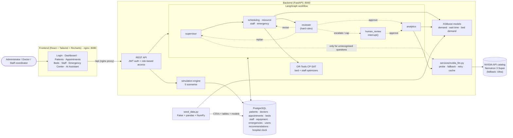

# Architecture

## Components

| Layer | Location | Responsibility |
|---|---|---|
| Frontend | `frontend/` | React 19 + TypeScript, Tailwind v4, Recharts, Axios. Role-aware navigation; every view has loading, empty and error states. Served by nginx, which proxies `/api` to the backend. |
| API | `backend/api/routes/` | FastAPI routers for auth, dashboard, patients, doctors, appointments, beds, staff, emergency, agent, scenarios and recommendations. JWT bearer auth (`core/security.py`) and role checks (`core/deps.py`). OpenAPI docs at `/docs`. |
| Agent workflow | `backend/langgraph_workflow/` | Typed state (`state.py`), supervisor, reviewer, human review, routing functions, graph assembly and a runner that maps graph runs to API responses. In-memory checkpointer; one `thread_id` per run. |
| Agents | `backend/agents/` | Scheduling, Resource, Staff and Emergency agents use deterministic tools. The Analytics agent uses the LLM to explain decisions, grounded in facts. |
| Optimisation | `backend/optimization/` | `optimize_beds()` and `optimize_staff()`: CP-SAT models with hard constraints and explicit `INFEASIBLE` reporting. Single worker for deterministic results. |
| Machine learning | `backend/ml/` | Three XGBoost regressors trained by `train.py` on the generated data: patient demand, waiting time, bed demand. |
| Simulation | `backend/simulation/` | Resets to the seeded baseline and applies one of five scenarios, after which the agents react. Also moves the hospital clock. |
| Data | `backend/seed/`, `backend/seed_data.py` | Seeded generator encoding realistic patterns (Monday admission peak, 8–12 AM appointment rush, night-time emergencies, ICU at 70–95%, seasonal spikes). Writes CSVs, loads PostgreSQL, trains models, creates demo users. |
| LLM | `backend/services/nvidia_llm.py` | Shared NVIDIA client: chat, JSON responses validated with Pydantic, model probing with fallback, exponential backoff, on-disk cache, call counting. |

## Why optimisation is deterministic and the LLM is only used to explain

| Concern | OR-Tools / Python rules | LLM |
|---|---|---|
| Correctness | CP-SAT proves an assignment meets every hard constraint, or proves none exists, with the reason. | Can produce plausible but wrong plans (double-booked beds, invented capacity). |
| Safety rules | Encoded once and enforced on every run by the reviewer. | Can be argued out of a rule. In our failure-mode runs it recommended clinical scoring and exceeding limits. |
| Reproducibility | Same input gives the same output, so drafts can be hashed to detect "no progress". | Sampling varies; repeated failure is harder to detect. |
| Cost | Free and fast. | Uses free-tier credits and is rate-limited (about 40 requests/min). |

So the LLM handles only what needs language: explaining decisions and answering questions
(Analytics agent), and routing questions that match no keyword (supervisor). Everything that must
be right (who gets which bed, who moves where, whether the plan is possible at all) is computed
and checked in code. A typical query costs one LLM call; a full scenario run costs one.

## Request flow: `POST /agent/query`

1. The API authenticates the JWT and passes the user's role to the runner.
2. The **supervisor** picks agents by keyword (with the LLM as fallback) and filters them by role:
   doctors reach scheduling, coordinators reach staff, admins reach all.
3. Each selected **agent** reads live state from PostgreSQL, runs its solver or model, and hands
   off to the next queued agent (conditional edge `route_next`).
4. The **reviewer** runs hard checks and decides: approve, revise, replan or escalate
   (conditional edge `route_after_review`).
5. On escalation, **human_review** calls `interrupt()`. The API returns `status: needs_human` with
   the `thread_id`, and `POST /agent/resume` continues the same checkpointed run.
6. The **analytics** agent writes the answer from facts only. Each agent output is stored as a
   pending recommendation that an admin can accept (which applies it) or override.

## Deployment

`docker compose up --build` starts three containers: `db` (PostgreSQL 17 with a volume),
`backend` (seeds on first start, then runs uvicorn) and `frontend` (nginx serving the built React
app). Generated CSVs, trained models and the LLM cache live on a `state` volume, so recreating
containers doesn't reseed. Environment: `DATABASE_URL`, `NVIDIA_API_KEY`, `JWT_SECRET`.
